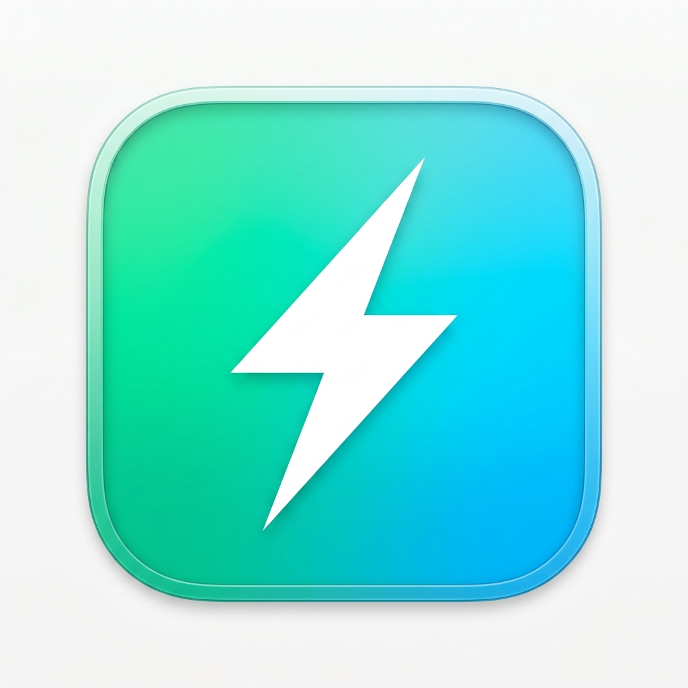
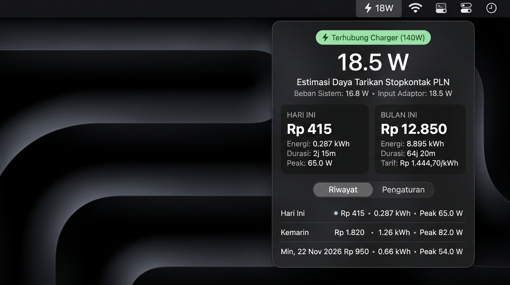

<div align="center">
  
  <h1>MacWattTracker ⚡</h1>
  <p><b>Aplikasi macOS Native Menu Bar untuk Memantau Konsumsi Listrik Stopkontak (PLN) Real-Time & Estimasi Biaya Token Listrik</b></p>
  <p><i>Dioptimalkan secara khusus untuk MacBook Pro Apple Silicon (M1 Pro, M1 Max, M2, M3, M4)</i></p>

  <p>
    
    
    
    
    
  </p>
</div>

---

<div align="center">
  
</div>

---

## 📖 Tentang MacWattTracker

**MacWattTracker** adalah aplikasi utilitas macOS native murni Menu Bar (*system tray*) yang dirancang khusus untuk memantau konsumsi daya listrik nyata yang ditarik dari stopkontak dinding (PLN) saat MacBook Anda terhubung ke charger.

Aplikasi ini mengakumulasikan penggunaan energi (**Wh & kWh**), menghitung estimasi biaya token listrik PLN harian dan bulanan, serta menyimpan catatan riwayat per hari hingga 90 hari terakhir.

---

## 🌟 Fitur Utama

### 1. Minimalis & Murni Berjalan di Menu Bar (Tray Only)
- Menggunakan `MenuBarExtra` SwiftUI dengan `LSUIElement = true`.
- **Tidak muncul di Dock maupun Cmd+Tab App Switcher**, menjaga layar kerja Anda tetap bersih.
- **Tampilan Tray Logo Eksklusif (2 Mode):**
  - **Saat Terhubung Charger:** Menampilkan ikon logo aplikasi (motif listrik) + angka Watt live (misal: `18W`).
  - **Saat Mode Baterai:** Menampilkan ikon logo aplikasi (motif baterai) murni tanpa label teks "Baterai", sehingga system tray Anda tetap sangat bersih dan rapi.
  - Informasi Rupiah dan rincian lengkap tersedia di dalam jendela popover vertikal yang lega (tinggi 680pt).

### 2. Logika Cerdas: Stopkontak PLN vs Mode Baterai
- **Saat Terhubung Charger (`ExternalConnected == true`):**
  - Mengambil daya masuk dari adaptor: `(SystemPowerIn > 0 ? SystemPowerIn : SystemLoad) / 1000.0`.
  - Mengalikan dengan **Faktor Efisiensi Adaptor** (default `1.10x` untuk memperhitungkan rugi daya konversi AC-ke-DC ~10% pada kepala charger Apple 140W/96W/67W).
  - Mengakumulasi konsumsi energi harian ($\text{Wh} = \text{Watt\_PLN} \times \frac{\Delta t}{3600}$).
  - Menambah durasi detik aktif tercolok charger (`activeSeconds`).
  - Memperbarui rekor daya tertinggi hari itu (`peakWatt`).
- **Saat Mode Baterai (`ExternalConnected == false`):**
  - Konsumsi daya baterai **sama sekali tidak dicatat** (`Watt PLN = 0.0 W`).
  - Tidak menambah Wh, kWh, maupun durasi aktif ke riwayat stopkontak.
  - Otomatis mereset penanda waktu sampling (`lastSampleTime = nil`) agar tidak terjadi lonjakan akumulasi waktu saat charger dicolokkan kembali.

### 3. Proteksi Sleep & Wake
- Terhubung langsung dengan notifikasi sistem `NSWorkspace.willSleepNotification` dan `NSWorkspace.didWakeNotification`.
- Jika terjadi selisih waktu antar-sampling ($\Delta t$) melebihi **60 detik** (misal saat layar MacBook ditutup atau sleep), interval tersebut diabaikan sehingga durasi sleep tidak terhitung sebagai konsumsi listrik aktif.

### 4. Pengaturan Tarif Listrik PLN Fleksibel
- **Default Tarif Resmi:** **Rp 1.444,70 / kWh** (Sesuai tarif resmi PLN golongan Rumah Tangga R-1/TR daya 1.300 VA dan 2.200 VA).
- **Input Bebas & Mendukung Desimal:** Anda dapat mengetik angka tarif berapa pun secara presisi hingga satuan sen.
- **Tombol Preset Cepat:**
  - `R-1 (1.444,70) • Default` (1.300 VA & 2.200 VA)
  - `R-2 (1.699,53)` (3.500 VA s/d 5.500 VA)
  - `Bisnis (1.444,70)` (Golongan B-1)
- Nilai tarif tersimpan secara persisten di `UserDefaults`.

### 5. Desain Clean Adaptif (Light & Dark Mode)
- Sepenuhnya menggunakan **Apple Semantic System Colors** (`windowBackgroundColor`, `controlBackgroundColor`, `primary`, `secondary`, `separatorColor`).
- **Light Mode:** Tampilan kartu cerah dan lembut dengan border hairline halus yang nyaman dipandang.
- **Dark Mode:** Tampilan gelap slate dengan kontras yang seimbang dan tidak menyilaukan.

### 6. Auto Start Terintegrasi (Launch at Login)
- Dilengkapi tombol toggle switch *"Buka Otomatis saat Mac Dinyalakan"* langsung di dalam aplikasi (menggunakan API resmi Apple `ServiceManagement` / `SMAppService`).
- Script instalasi `./build.sh --install` juga secara otomatis mendaftarkan aplikasi ke Login Items macOS.

### 7. Riwayat Harian 90 Hari & Ekspor CSV
- Agregasi harian disimpan otomatis ke file JSON lokal di `~/Library/Application Support/MacWattTracker/daily_history.json`.
- Mendukung ekspor seluruh riwayat ke file spreadsheet `.csv` melalui menu Pengaturan.

### 8. Dukungan Widget macOS (Small, Medium, & Large)
MacWattTracker kini dilengkapi **WidgetKit Extension** native yang dapat dipasang di **Desktop macOS** maupun **Notification Center**:
- **Small Widget:** Menampilkan status charger (`⚡ 140W`), Watt PLN live, biaya listrik Hari Ini (`Rp ...`), serta durasi & kWh aktif.
- **Medium Widget:** Tampilan horizontal 2 kolom membandingkan daya stopkontak real-time dengan ringkasan konsumsi energi Hari Ini dan Bulan Ini.
- **Large / High Widget:** Tampilan dashboard lengkap berisi meteran Watt stopkontak, kartu ringkasan ganda, serta riwayat pemakaian beberapa hari terakhir.

*Cara Menambahkan Widget ke Desktop macOS:*
1. Klik kanan pada area kosong di **Desktop macOS**, lalu pilih **"Edit Widgets..."** (atau buka Notification Center > klik tombol **"Edit Widgets"** di bagian paling bawah).
2. Cari atau pilih **MacWattTracker** pada daftar aplikasi di sebelah kiri.
3. Pilih ukuran widget yang diinginkan (**Small**, **Medium**, atau **Large**), lalu tarik (*drag*) ke Desktop Anda.

---

## 📐 Rumus & Perhitungan

$$\text{Daya PLN (Watt)} = \frac{\text{SystemPowerIn (mW)}}{1000} \times \text{Efisiensi (1.10)}$$

$$\text{Energi Terpakai (Wh)} = \sum \left( \text{Watt PLN} \times \frac{\Delta t}{3600} \right)$$

$$\text{Total kWh} = \frac{\text{Total Wh}}{1000}$$

$$\text{Estimasi Biaya Listrik (Rp)} = \text{Total kWh} \times \text{Tarif per kWh (Rp 1.444,70)}$$

---

## 🛠️ Panduan Build & Instalasi (CLI Ready)

Proyek ini menggunakan **Swift Package Manager (SPM)** dan script build bash murni tanpa memerlukan Xcode GUI.

### 1. Prasyarat
- macOS 13.0 (Ventura) atau versi lebih baru (Sonoma / Sequoia).
- Arsitektur Apple Silicon (M1/M2/M3/M4).
- Command Line Tools / Swift compiler (`swift --version`).

### 2. Compile & Rakit Bundle `.app`
```bash
git clone git@github.com:bayuly94/MacWattTracker.git
cd MacWattTracker
chmod +x build.sh
./build.sh
```

### 3. Instal ke `/Applications` & Aktifkan Auto Start
Gunakan flag `--install`:
```bash
./build.sh --install
```
Script ini secara otomatis:
1. Meng-compile biner dalam mode release.
2. Membungkus biner dan `Info.plist` menjadi bundle `MacWattTracker.app`.
3. Menandatangani bundle aplikasi dengan ad-hoc codesigning.
4. Memasang `MacWattTracker.app` ke direktori `/Applications`.
5. Mendaftarkan aplikasi ke *Login Items* macOS (Auto Start saat Mac dinyalakan).
6. Langsung menjalankan aplikasi di Menu Bar.

---

## 🚀 Pengaturan Buka Otomatis (Auto Start)

### Melalui Menu Aplikasi
Buka jendela popover MacWattTracker di Menu Bar > pilih tab **Pengaturan** > aktifkan toggle **"Buka Otomatis saat Mac Dinyalakan"**.

### Melalui Terminal
```bash
osascript -e 'tell application "System Events" to make login item at end with properties {path:"/Applications/MacWattTracker.app", hidden:false, name:"MacWattTracker"}'
```

*Untuk menghapus dari Login Items:*
```bash
osascript -e 'tell application "System Events" to delete login item "MacWattTracker"'
```

---

## 📁 Struktur Berkas Proyek

```
MacWattTracker/
├── Package.swift                             # SPM manifest (multi-target: Core, App, Widget)
├── Info.plist                                # LSUIElement=true & bundle identity
├── build.sh                                  # Script compile, bundle, sign, install & widget registration
├── README.md                                 # Dokumentasi lengkap
├── .gitignore                                # Git ignore (.build, .cache, *.app, dsb.)
├── assets/
│   ├── logo.png                              # Ikon resmi aplikasi MacWattTracker
│   └── screenshot.png                        # Tangkapan layar antarmuka & Menu Bar
└── Sources/
    ├── MacWattTrackerCore/                   # Shared module antara App & Widget
    │   ├── DailyRecord.swift                 # Struktur data agregasi harian (Wh, kWh, durasi, peak)
    │   └── LivePowerStatus.swift             # Model status live snapshot untuk WidgetKit
    ├── MacWattTracker/                       # Aplikasi Utama (Menu Bar Extra)
    │   ├── MacWattTrackerApp.swift          # @main entry point dengan MenuBarExtra
    │   ├── HistoryStore.swift                # Pengelola JSON lokal & ekspor file CSV
    │   ├── PowerMonitor.swift                # Polling ioreg 5 dtk, proteksi sleep, rumus PLN
    │   └── MenuBarPopoverView.swift          # Antarmuka popover SwiftUI adaptif Light/Dark mode
    └── MacWattTrackerWidget/                 # macOS WidgetKit Extension
        └── MacWattTrackerWidget.swift        # Implementasi Widget Small, Medium, & Large
```

---

## 📄 Lisensi
Didistribusikan di bawah lisensi MIT. Silakan gunakan, modifikasi, dan kembangkan sesuai kebutuhan Anda.
